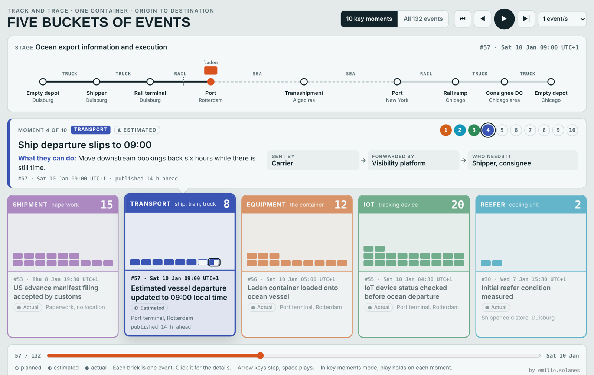

# Track and Trace Simulator: one container, five buckets of events

Built by emilio.solanes. Personal project, not affiliated with or endorsed by any company. Simulated data.

One temperature-controlled container travels from a cold store in Duisburg by rail to Rotterdam, by sea through Algeciras to New York, by rail to Chicago and by truck to the consignee, then back empty to a depot. Along the way it produces 132 events, and each one lands in one of five buckets, the event types of the DCSA Track and Trace standard (3.0):

| Bucket | What it covers | Events |
|---|---|---|
| Shipment | the paperwork: booking, certificates, transport document, customs, release, proof of delivery | 27 |
| Transport | ships, trains and trucks arriving and departing | 18 |
| Equipment | the container itself: picked up, gated in and out, loaded, discharged, inspected | 30 |
| IoT | the tracking device: geofences, motion, doors, location updates, device status | 52 |
| Reefer | the cooling unit: setpoint and measurements | 5 |

Ten key moments tell the story: for each one the page shows who typically sends the event, who forwards it, who needs it and what they can do with it, plus when the event was published compared with when it happened. The senders, forwarders and receivers are typical roles, shown for illustration.



Open `index.html` in any current browser. It is a single self-contained file and runs offline; without internet the page falls back to system fonts. To share a link instead, enable GitHub Pages (Settings, Pages, Deploy from branch, `main`, root).

## How to use it

- **10 key moments** (default): ▶| jumps to the next moment and the buckets fill on the way. Play runs event by event and holds 5 s on each moment. The numbered chips jump straight to a moment.
- **All 132 events**: steps one event at a time.
- Click a block for the event card. Click a stop on the route to jump there. Arrow keys step, space plays, up and down move between blocks in a bucket.

Planned events are hollow blocks, estimated events half filled, actual events filled.

## The storyline

`data/story.json` holds one record per event: bucket, classifier (planned, estimated, actual), the specific event type in plain words, the business milestone, a generic place, the position on the route, laden or empty, the mode of transport, the time of the event and the time it was published, and the local time zone. Event numbers follow the page order; `xl` is the row in the source storyline.

The storyline is illustrative. Places are generic and company names are left out. A few points were corrected so the flow matches practice: the US advance manifest is filed more than 24 hours before loading, the truck arrives at the rail ramp before the box gates in, two events got their mode of transport, and the customs exam in New York takes from Friday to Monday, so delivery in Chicago is on Friday 30 January. Every event matches a combination in the standard's event list.

Not included: message payloads, API field names, the source storyline workbook and the validation tools.

## Build and test

```
python3 build.py            # index.html from src/page.html and data/story.json
python3 test/test_story.py  # event order, moments, the 24 hour manifest rule, and no company names, payload fields or em dashes in the public files
```

Edit `src/page.html` or `data/story.json`, then rebuild. `index.html` is generated, so edits made directly in it are lost on the next build.

`window.__tnt` exposes hooks for scripted use (jump, play, step, mode, read state, open a card), used to record the video.

## Series

Part three, after the [Port Call Simulator](https://github.com/emiliosolanes/port-call-simulator) (one ship across two ports, and one terminal over 48 hours).

## License

MIT, see `LICENSE`. Simulated data. Personal project, not affiliated with the companies shown.
